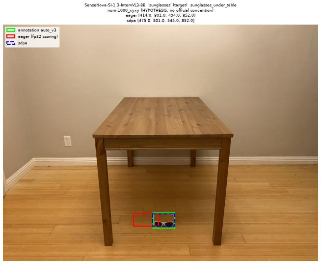
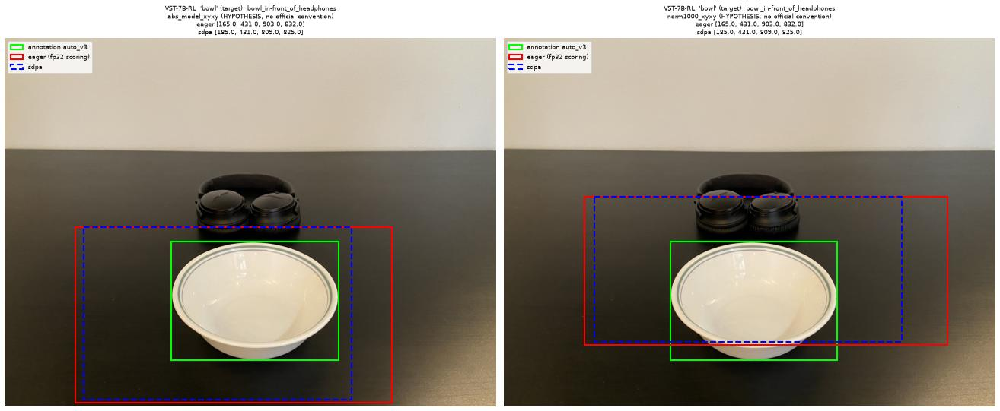

# 框预测：sdpa 与修复后 eager 的大差异样本

脚本 `scripts/bbox_impl_diff_cases.py`（CPU，只读已保存的结果）。筛选口径：两边都能解析出四个数，原始输出数字的最大绝对差 ≥ 50；第一组 9 个模型、每个 40 条框提示，共 5 条。
没有计算正确率。参照框是 What's Up 标注 auto_v3 的检测框（自动标注，经模型辅助预审和部分人工复核）；5 条涉及的 4 张图在审核表里都是 `ok`，来源都是 `ai_prereview_thumbnail_only`（未经用户逐张检查），v3 没有改动它们的框。

## 1. 五条样本

<!-- CASES_BEGIN -->
| # | 模型 | 图像 | 真值物体（角色） | eager 原始输出 | sdpa 原始输出 | 最大差 | 换算约定 | eager 框（原图像素） | sdpa 框（原图像素） | 两框 IoU | 标注框 v3（原图像素） |
|---|---|---|---|---|---|---|---|---|---|---|---|
| 1 | InternVL3-8B | whatsup_a / pan_left_of_chair | pan（target） | `[2, 775, 362, 1000]` | `[228, 766, 372, 876]` | 226 | 0–1000 归一化（官方） | [3, 744, 463, 960] | [292, 735, 476, 841] | 0.16 | [285, 741, 492, 838] |
| 2 | InternVL3-8B | whatsup_a / pillow_left_of_armchair | pillow（target） | `[54, 700, 262, 921]` | `[54, 760, 265, 949]` | 60 | 0–1000 归一化（官方） | [69, 672, 335, 884] | [69, 730, 339, 911] | 0.64 | [60, 735, 425, 895] |
| 3 | SenseNova-SI-1.2-InternVL3-8B | whatsup_b / bowl_in-front_of_headphones | bowl（target） | `[0.338, 546, 0.68, 0.877]` | `[0.34, 0.55, 0.67, 0.876]` | 545.45 | 0–1 归一化（假设，无官方约定） | 无效（第二个数超出图像） | [435, 528, 858, 841] | — | [435, 530, 869, 839] |
| 4 | SenseNova-SI-1.3-InternVL3-8B | whatsup_a / sunglasses_under_table | sunglasses（target） | `[414, 801, 494, 852]` | `[475, 801, 545, 852]` | 61 | 0–1000 归一化（假设，无官方约定） | [530, 769, 632, 818] | [608, 769, 698, 818] | 0.15 | [610, 765, 699, 826] |
| 5 | VST-7B-RL | whatsup_b / bowl_in-front_of_headphones | bowl（target） | `[165, 431, 903, 832]` | `[185, 431, 809, 825]` | 94 | 模型图像像素（假设，无官方约定） | [184, 493, 1007, 951] | [206, 493, 902, 943] | 0.83 | [435, 530, 869, 839] |
|  |  |  |  |  |  |  | 0–1000 归一化（假设，无官方约定） | [211, 414, 1156, 799] | [237, 414, 1036, 792] | 0.83 | [435, 530, 869, 839] |

图例：绿 = 标注 auto_v3 检测框，红 = eager（float32 打分，bf16），蓝虚线 = sdpa（bf16）。第 5 条两种换算假设各一幅。

**#1 InternVL3-8B：pan_left_of_chair / pan**

**#2 InternVL3-8B：pillow_left_of_armchair / pillow**

**#3 SenseNova-SI-1.2-InternVL3-8B：bowl_in-front_of_headphones / bowl**

**#4 SenseNova-SI-1.3-InternVL3-8B：sunglasses_under_table / sunglasses**

**#5 VST-7B-RL：bowl_in-front_of_headphones / bowl**

<!-- CASES_END -->

完整记录（提示词、原始文本、首个不同的 token 位置）：`outputs/diagnostics/bbox_impl_diff/cases.json`。

## 2. 看图后的判断

- **样本没有歧义。** 5 条对应的 4 张图里，被问的物体都只有一个、完整可见、背景干净。差异不能归因于样本。
- **第 3 条不是“完全不同的框”。** eager 的第二个数是 `546`，其余三个数都是 0–1 小数，看起来是漏写了 `0.`；若读成 0.546 就与 sdpa 的 0.55 相近。之前把它说成“相差 545、给出完全不同的框”是不准确的，它是格式错误，并使该条输出不可用。
- **第 1、4 条是真正不同的框**：eager 的框偏离物体，sdpa 的框贴着物体。第 2 条是同一物体、上下错开约 5%。第 5 条两者重叠 0.83，都与物体不太贴合。
- **“eager 一侧更差”这个初步印象没有得到 float32 对照的支持**（第 3 节）：第 1、2 条上 float32 的输出都接近 bf16 的 eager；第 1 条里 bf16 sdpa 那个贴合的框反而是偏离 float32 的一方。第 3–5 条的模型没有做 float32 对照。

## 3. float32 对照（InternVL3-8B，2 张卡，同样的 40 条框提示）

脚本 `scripts/check_fp32_sdpa_vs_eager.py`，结果 `outputs/diagnostics/fp32_sdpa_vs_eager_InternVL3-8B_r2.json`（作业 435763）。
第一次运行（435682，文件名不带 `_r2`）的切换探针在双卡下报错，未能证明切换生效，因此改用调用计数重跑；两次运行的 token 全部相同。

**切换生效的证据**：语言模型层里，eager 两轮各调用 `eager_attention_forward` 29,708 次、sdpa 0 次；sdpa 两轮相反。首步 logits 不是逐位相同（最大差 8.4e-5），说明走的确实是两条路径。参数全部是 float32。切换的只有语言模型；视觉塔（`_naive_attn`）两种设置下相同。

| 比较 | 逐 token 一致 | 不一致条目的坐标最大差 |
|---|---|---|
| **float32：eager 与 sdpa** | **40/40** | — |
| float32：同一设置重复一遍（eager / sdpa） | 40/40、40/40 | — |
| bf16：eager 与 sdpa（已存结果） | 34/40 | 最大 226，2 条 ≥ 50 |
| eager：float32 与 bf16 | 31/40 | 最大 74，1 条 ≥ 50 |
| sdpa：float32 与 bf16 | 29/40 | 最大 226，3 条 ≥ 50 |

两条大差异样本在三种设置下的输出：

| 样本 | bf16 eager | bf16 sdpa | float32（eager 与 sdpa 相同） |
|---|---|---|---|
| pan_left_of_chair / pan | [2, 775, 362, 1000] | [228, 766, 372, 876] | [2, 775, 369, 987] |
| pillow_left_of_armchair / pillow | [54, 700, 262, 921] | [54, 760, 265, 949] | [54, 700, 266, 928] |

- 在这个模型、这 40 条上，float32 消除了两种实现的差异；bf16 下的差异来自精度，不是 eager 补丁写错。
- bf16 与 float32 本身不是同一个模型行为：约四分之一的框输出不同。两种实现在 bf16 下相同、但与 float32 差 74 的有 1 条（`bottle-of-orange-juice_on_chair` 的 chair：bf16 [365, 275, 646, 821]，float32 [370, 276, 635, 895]）。
- 代价：40 条框提示 eager 56 秒、sdpa 52 秒；峰值显存两卡合计 29.9 GB（13.74 + 16.15，未取注意力权重、未挂干预 hook）。之前“单卡 40 GB 放不下”的说法已在第 5 节更正；InternVL3-8B 单卡没有测过。
- 限制：只有一个模型、40 条；不含关系提示；不能外推到视觉 token 更多的模型。

## 4. teacher-forced 读出（InternVL3-8B，作业 435836，gpu-55，commit eb9db24）

脚本 `scripts/teacher_forced_readout.py`（GPU）、`scripts/compare_teacher_forced.py`（汇总）；结果 `outputs/diagnostics/teacher_forced_InternVL3-8B_{bf16,fp32}.json`、`teacher_forced_compare_InternVL3-8B.json`。读出量的定义在 `src/readout.py` 开头。

- 输入：与第 3 节相同的 40 条框提示，每条 4 个坐标，共 160 个坐标；四种组合（bf16 / fp32 × eager / sdpa）各 40 条，出错 0、OOM 0、NaN 0。
- **走了 fp32 / 切换生效的证据**：fp32 运行的参数 dtype 只有 `torch.float32`，bf16 运行只有 `torch.bfloat16`；语言模型层的调用计数 eager 轮 19,040 次 eager / 0 次 sdpa，sdpa 轮相反（两种精度都如此）。eager 的 float32 打分补丁已生效（28 层）。切换的只有语言模型，视觉塔不变。
- 表注：**“真值”用的是 What's Up v3 的检测框 `box_det_xyxy`，不是之后确定的默认真值框 `box_gt_xyxy`**。这里比较的是实现之间的差异，不受这一点影响；数值不能当作对新真值框的读出。差异 = 绝对差；期望坐标单位 0–1000，对数概率单位 nat。“模型自带” = 模型的 lm_head（bf16 模型里是 bf16）；“float32” = 同一个末层隐状态、lm_head 用 float32 算（fp32 模型里两者相同，不重复列）。

| 读出量 | lm_head | 比较 | n | 均值 | 中位数 | 95% 分位 | 最大 |
|---|---|---|---|---|---|---|---|
| 期望坐标（精确枚举，0–1000 单位） | 模型自带 | bf16 eager vs bf16 sdpa | 160 | 0.449 | 0.126 | 1.97 | 5.04 |
| 期望坐标（精确枚举，0–1000 单位） | 模型自带 | fp32 eager vs fp32 sdpa | 160 | 0.000149 | 4.55e-05 | 0.000597 | 0.00643 |
| 期望坐标（精确枚举，0–1000 单位） | 模型自带 | bf16 eager vs fp32 eager | 160 | 0.79 | 0.168 | 4.39 | 14 |
| 期望坐标（精确枚举，0–1000 单位） | 模型自带 | bf16 sdpa vs fp32 sdpa | 160 | 0.816 | 0.199 | 3.68 | 13.7 |
| 期望坐标（精确枚举，0–1000 单位） | float32 | bf16 eager vs bf16 sdpa | 160 | 0.55 | 0.142 | 2.75 | 7.64 |
| 期望坐标（精确枚举，0–1000 单位） | float32 | bf16 eager vs fp32 eager | 160 | 0.802 | 0.153 | 3.77 | 15.1 |
| 期望坐标（精确枚举，0–1000 单位） | float32 | bf16 sdpa vs fp32 sdpa | 160 | 0.769 | 0.179 | 3.73 | 22.5 |
| 期望坐标（逐位条件，0–1000 单位） | 模型自带 | bf16 eager vs bf16 sdpa | 160 | 1.1 | 0.234 | 4.01 | 30 |
| 期望坐标（逐位条件，0–1000 单位） | 模型自带 | fp32 eager vs fp32 sdpa | 160 | 0.000197 | 6.1e-05 | 0.000525 | 0.00671 |
| 期望坐标（逐位条件，0–1000 单位） | 模型自带 | bf16 eager vs fp32 eager | 160 | 1.3 | 0.302 | 6.34 | 15.7 |
| 期望坐标（逐位条件，0–1000 单位） | 模型自带 | bf16 sdpa vs fp32 sdpa | 160 | 1.25 | 0.325 | 4.94 | 16.2 |
| 期望坐标（逐位条件，0–1000 单位） | float32 | bf16 eager vs bf16 sdpa | 160 | 1.08 | 0.284 | 3.53 | 28.1 |
| 期望坐标（逐位条件，0–1000 单位） | float32 | bf16 eager vs fp32 eager | 160 | 1.23 | 0.262 | 5.74 | 14.8 |
| 期望坐标（逐位条件，0–1000 单位） | float32 | bf16 sdpa vs fp32 sdpa | 160 | 1.13 | 0.312 | 4.6 | 24.7 |
| 真值数字串对数概率（nat，每个坐标） | 模型自带 | bf16 eager vs bf16 sdpa | 160 | 0.118 | 0.0836 | 0.359 | 0.786 |
| 真值数字串对数概率（nat，每个坐标） | 模型自带 | fp32 eager vs fp32 sdpa | 160 | 2.45e-05 | 1.66e-05 | 6.28e-05 | 0.000203 |
| 真值数字串对数概率（nat，每个坐标） | 模型自带 | bf16 eager vs fp32 eager | 160 | 0.116 | 0.0991 | 0.331 | 1 |
| 真值数字串对数概率（nat，每个坐标） | 模型自带 | bf16 sdpa vs fp32 sdpa | 160 | 0.129 | 0.0962 | 0.389 | 0.649 |
| 真值数字串对数概率（nat，每个坐标） | float32 | bf16 eager vs bf16 sdpa | 160 | 0.106 | 0.0809 | 0.303 | 0.685 |
| 真值数字串对数概率（nat，每个坐标） | float32 | bf16 eager vs fp32 eager | 160 | 0.11 | 0.0835 | 0.314 | 0.98 |
| 真值数字串对数概率（nat，每个坐标） | float32 | bf16 sdpa vs fp32 sdpa | 160 | 0.124 | 0.0838 | 0.375 | 0.652 |

- **fp32 下两种实现的差异可以忽略**：期望坐标最大差 0.0064（0–1000 单位），对数概率最大差 2.0e-4 nat。
- **bf16 下两种实现的期望坐标（精确枚举）**：均值 0.45、中位数 0.13、最大 5.0；160 个坐标里 1 个差 > 5，没有差 > 50 的。比自由生成的差异小得多（第 1、3 节：同一模型 40 条里 6 条 token 不同，最大差 226）。两者不是同一个量：teacher-forced 每一步都给真值前缀，看不到自由生成里一个 token 分叉后的连锁放大。
- **bf16 对 fp32 的差异比 bf16 内部两种实现的差异更大**：期望坐标均值 0.79（eager）/ 0.82（sdpa），最大 14.0 / 13.7。
- lm_head 改用 float32 算没有让 bf16 的差异变小（精确枚举的均值 0.45 → 0.55），说明差异主要来自隐状态，不是 lm_head 的量化。
- 互检：同一个量（真值数字串的对数概率，159 个三位数坐标）用“一次完整前向”和“KV cache + 批量枚举”两条路径算，fp32 下最大差 1.6e-4 nat，说明读出代码一致；bf16 下中位数 0.06–0.11、最大 0.42–0.81 nat，与 bf16 两种实现之间的差异（中位数 0.08、最大 0.79）**同一量级**。也就是说 bf16 下换一种等价算法本身就会带来这么大的数值差，两种注意力实现的差异没有明显超出这个底噪。枚举覆盖的概率质量最小 0.99996。
- 耗时（每条，含全部读出）：bf16 eager 1.30 秒、sdpa 1.11 秒（1 张卡）；fp32 eager 3.26 秒、sdpa 3.31 秒（2 张卡）。峰值显存：bf16 19.2 GB（1 卡）；fp32 15.93 + 18.85 = 34.78 GB（2 卡）。fp32 的 teacher-forced 没有测单卡。
- 限制：只有一个模型、40 条；不含关系提示。

### 4.1 |e_tree 差| 最大的 10 个坐标（bf16 对 fp32，eager）

脚本 `scripts/teacher_forced_top_diffs.py`（CPU，只读已有 JSON），结果 `outputs/diagnostics/teacher_forced_top10_InternVL3-8B.json`。e_tree 单位 0–1000，lm_head 用模型自带；“真值”是检测框。

| # | 样本 / 角色 | 物体 | 坐标 | 真值（检测框） | bf16 eager | bf16 sdpa | fp32 eager | fp32 sdpa | 差（bf16 − fp32，eager，绝对值） | fp32 对真值的对数概率 | 是否第 1 节的 pan / pillow 样本 |
|---|---|---|---|---|---|---|---|---|---|---|---|
| 1 | sunglasses_under_table / reference | table | y2 | 937 | 706.0 | 705.7 | 692.0 | 692.0 | 14.04 | -4.95 | 否 |
| 2 | pillow_on_table / target | pillow | y2 | 438 | 446.0 | 445.9 | 455.9 | 455.9 | 9.96 | -5.26 | 否 |
| 3 | bowl_in-front_of_headphones / reference | headphones | y2 | 539 | 532.7 | 536.0 | 539.7 | 539.7 | 7.04 | -4.59 | 否 |
| 4 | glasses_right_of_armchair / target | glasses | x1 | 722 | 394.1 | 396.8 | 400.9 | 400.9 | 6.77 | -9.36 | 否 |
| 5 | knife_left_of_chair / target | knife | x1 | 250 | 200.1 | 197.4 | 206.1 | 206.1 | 5.99 | -4.65 | 否 |
| 6 | mug_right_of_table / target | mug | x1 | 758 | 639.4 | 643.7 | 645.0 | 645.0 | 5.62 | -4.90 | 否 |
| 7 | ball-of-yarn_on_chair / target | ball of yarn | y1 | 535 | 361.9 | 361.7 | 357.3 | 357.3 | 4.65 | -6.60 | 否 |
| 8 | knife_left_of_chair / target | knife | y1 | 757 | 728.9 | 727.9 | 724.5 | 724.5 | 4.45 | -3.54 | 否 |
| 9 | shoes_under_chair / target | shoes | y1 | 762 | 732.8 | 731.5 | 728.4 | 728.4 | 4.39 | -5.26 | 否 |
| 10 | pillow_on_table / target | pillow | y1 | 313 | 320.9 | 320.9 | 325.1 | 325.1 | 4.28 | -7.10 | 否 |

- pan_left_of_chair / target：真值 [223, 772, 385, 873]；e_tree bf16 eager [166.4, 762.7, 356.6, 883.1]、bf16 sdpa [161.4, 763.0, 358.2, 883.3]、fp32 eager [168.2, 762.7, 359.2, 883.0]、fp32 sdpa [168.2, 762.7, 359.2, 883.0]；bf16 对 fp32（eager）四个坐标的差 [1.7, 0.0, 2.6, 0.1]，其中最大者在 160 个坐标里排第 16。
- pillow_left_of_armchair / target：真值 [47, 765, 332, 932]；e_tree bf16 eager [53.6, 730.3, 265.0, 942.1]、bf16 sdpa [53.6, 730.2, 264.9, 941.7]、fp32 eager [53.5, 727.5, 265.5, 941.4]、fp32 sdpa [53.5, 727.5, 265.5, 941.4]；bf16 对 fp32（eager）四个坐标的差 [0.1, 2.8, 0.4, 0.7]，其中最大者在 160 个坐标里排第 15。

- **前 10 个都不属于第 1 节的 pan / pillow 两条**（`pillow_on_table` 与 `pillow_left_of_armchair` 是不同样本）；那两条样本在 teacher-forced 下的差只有 2.6 和 2.8，排第 16 和 15。所以自由生成里的大差异不对应 teacher-forced 读出里的大差异。
- 这 10 个坐标 fp32 给真值的对数概率都很低（−3.5 到 −9.4），期望值常远离真值（如 glasses x1 真值 722，期望约 400）：分布宽、多峰，期望对概率的小变化敏感。fp32 的 eager 与 sdpa 在这 10 个上相同（精度到 0.1）。

## 5. float32 + eager 的显存与耗时（作业 435836）

脚本 `scripts/bench_attention_memory.py`；结果 `outputs/diagnostics/bench_attn_{Qwen2.5-VL-7B-Instruct,InternVL3_5-8B}_{1gpu,2gpu}.json`。冒烟图的前 5 张（target 的框提示），每种先预热 1 次，耗时取 5 条的中位数。A100 40 GB（可用 39.49 GB）。没有 offload 到 CPU。
参数 dtype 确认只有 `torch.float32`；注意力权重能取出（28 / 36 层，float32），说明走的是 eager，但**这个脚本没有做实现调用计数**。bf16 和 sdpa 没有测。

| 模型 | 卡数 | 视觉 token | 操作 | 峰值 allocated（GB，逐卡） | 峰值 reserved（GB） | 每条秒数 | 成功 / 出错或 OOM |
|---|---|---|---|---|---|---|---|
| Qwen2.5-VL-7B-Instruct | 1 | 1230 | 前向，不取注意力 | 34.08 | 34.32 | 1.83 | 5 / 0 |
| Qwen2.5-VL-7B-Instruct | 1 | 1230 | 前向，全部层注意力留在 GPU | 37.22 | 38.74 | 1.83 | 5 / 0 |
| Qwen2.5-VL-7B-Instruct | 1 | 1230 | 前向，逐层注意力搬到 CPU | 34.08 | 34.33 | 3.98 | 5 / 0 |
| Qwen2.5-VL-7B-Instruct | 1 | 1230 | 框提示贪心生成 | 34.06 | 34.31 | 2.89 | 5 / 0 |
| Qwen2.5-VL-7B-Instruct | 2 | 1230 | 前向，不取注意力 | 19.03 + 15.80 = 34.83 | 19.27 + 17.14 | 1.84 | 5 / 0 |
| Qwen2.5-VL-7B-Instruct | 2 | 1230 | 前向，全部层注意力留在 GPU | 22.15 + 18.32 = 40.47 | 22.92 + 19.49 | 1.87 | 5 / 0 |
| Qwen2.5-VL-7B-Instruct | 2 | 1230 | 前向，逐层注意力搬到 CPU | 19.03 + 15.80 = 34.83 | 19.27 + 17.14 | 4.08 | 5 / 0 |
| Qwen2.5-VL-7B-Instruct | 2 | 1230 | 框提示贪心生成 | 19.01 + 15.63 = 34.64 | 19.25 + 15.79 | 3.23 | 5 / 0 |
| InternVL3_5-8B | 1 | 256 | 前向，不取注意力 | 31.99 | 32.36 | 0.41 | 5 / 0 |
| InternVL3_5-8B | 1 | 256 | 前向，全部层注意力留在 GPU | 32.44 | 32.83 | 0.41 | 5 / 0 |
| InternVL3_5-8B | 1 | 256 | 前向，逐层注意力搬到 CPU | 31.99 | 32.34 | 0.68 | 5 / 0 |
| InternVL3_5-8B | 1 | 256 | 框提示贪心生成 | 31.97 | 32.05 | 1.49 | 5 / 0 |
| InternVL3_5-8B | 2 | 256 | 前向，不取注意力 | 15.13 + 17.02 = 32.15 | 15.16 + 17.32 | 0.38 | 5 / 0 |
| InternVL3_5-8B | 2 | 256 | 前向，全部层注意力留在 GPU | 15.24 + 17.27 = 32.51 | 15.30 + 17.60 | 0.38 | 5 / 0 |
| InternVL3_5-8B | 2 | 256 | 前向，逐层注意力搬到 CPU | 15.13 + 17.02 = 32.15 | 15.21 + 17.32 | 0.68 | 5 / 0 |
| InternVL3_5-8B | 2 | 256 | 框提示贪心生成 | 15.12 + 16.96 = 32.08 | 15.16 + 16.98 | 1.82 | 5 / 0 |

- **更正**：我之前说“7B–8B 模型 float32 + eager 单卡 40 GB 放不下”，不对。Qwen2.5-VL-7B（1,230 个视觉 token）单卡放得下，但很紧：全部层注意力留在 GPU 时 allocated 37.22 GB、reserved 38.74 GB，再加干预 hook 或更长的序列就可能 OOM；逐层搬到 CPU 为 34.08 GB，耗时约 2.2 倍。InternVL3_5-8B（256 个视觉 token）单卡 32–33 GB。
- 2 张卡不更快，但每卡峰值降到 15–23 GB，留出做干预的余量。

## 6. 各模型、各组合的覆盖情况

| 模型 | bf16 eager 对 sdpa 逐 token 一致（框 / 关系） | fp32 eager 对 sdpa | bf16 对 fp32 | teacher-forced | fp32 显存 / 耗时 |
|---|---|---|---|---|---|
| InternVL3-8B | 34/40 / 20/20 | 框 40/40（关系未测） | 框：eager 31/40、sdpa 29/40 | 四种组合（第 4 节） | 只有生成与 teacher-forced 的 2 卡数字（第 3、4 节） |
| Qwen2.5-VL-7B | 23/40 / 20/20 | 未测 | 未测 | 未测 | 第 5 节 |
| InternVL3_5-8B | 24/40 / 20/20 | 未测 | 未测 | 未测 | 第 5 节 |
| Qwen3-VL-8B | 20/40 / 20/20 | 未测 | 未测 | 未测 | 未测 |
| RoboBrain2.0-7B | 23/40 / 20/20 | 未测（排查时旧的 float32 + eager 单卡 OOM） | 未测 | 未测 | 未测 |
| VST-7B-RL | 15/40 / 20/20 | 未测 | 未测 | 未测 | 未测 |
| GLM-4.6V（新分辨率） | 29/40 / 18/20 | 未测 | 未测 | 未测 | 未测 |
| SenseNova-SI-1.2 | 26/40 / 20/20 | 未测 | 未测 | 未测 | 未测 |
| SenseNova-SI-1.3 | 19/40 / 20/20 | 未测 | 未测 | 未测 | 未测 |

bf16 列引自 DATA_REPORT 1.5（作业 435451；GLM 为 435862）；fp32 生成引自第 3 节（作业 435763）。
