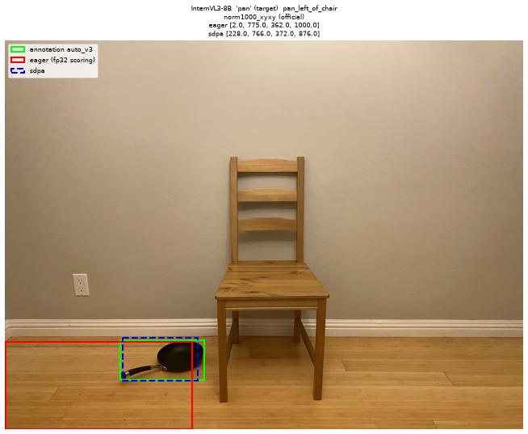
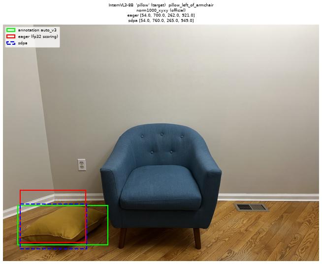
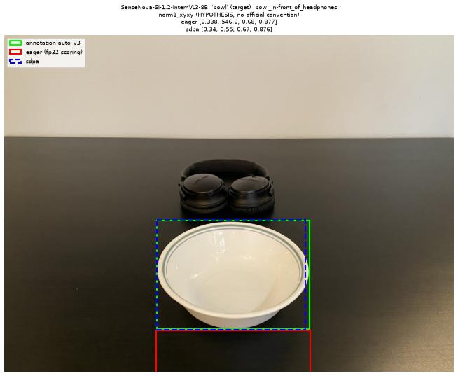

# 框预测：sdpa 与修复后 eager 的大差异样本

脚本 `scripts/bbox_impl_diff_cases.py`（CPU，只读已保存的结果）。筛选口径：两边都能解析出四个数，原始输出数字的最大绝对差 ≥ 50；第一组 9 个模型、每个 40 条框提示，共 5 条。
没有计算正确率。参照框是 What's Up 标注 auto_v3 的检测框（自动标注，经模型辅助预审和部分人工复核）；5 条涉及的 4 张图在审核表里都是 `ok`，来源都是 `ai_prereview_thumbnail_only`（未经用户逐张检查），v3 没有改动它们的框。

## 1. 五条样本

<!-- CASES_BEGIN -->
| # | 模型 | 图像 | 真值物体（角色） | eager 原始输出 | sdpa 原始输出 | 最大差 | 换算约定 | eager 框（原图像素） | sdpa 框（原图像素） | 两框 IoU | 标注框 v3（原图像素） |
|---|---|---|---|---|---|---|---|---|---|---|---|
| 1 | InternVL3-8B | whatsup_a / pan_left_of_chair | pan（target） | `[2, 775, 362, 1000]` | `[228, 766, 372, 876]` | 226 | 0–1000 归一化（官方） | [3, 744, 463, 960] | [292, 735, 476, 841] | 0.16 | [285, 741, 492, 838] |
| 2 | InternVL3-8B | whatsup_a / pillow_left_of_armchair | pillow（target） | `[54, 700, 262, 921]` | `[54, 760, 265, 949]` | 60 | 0–1000 归一化（官方） | [69, 672, 335, 884] | [69, 730, 339, 911] | 0.64 | [60, 735, 425, 895] |
| 3 | SenseNova-SI-1.2-InternVL3-8B | whatsup_b / bowl_in-front_of_headphones | bowl（target） | `[0.338, 546, 0.68, 0.877]` | `[0.34, 0.55, 0.67, 0.876]` | 545.45 | 0–1 归一化（假设，无官方约定） | 无效（第二个数超出图像） | [435, 528, 858, 841] | — | [435, 530, 869, 839] |
| 4 | SenseNova-SI-1.3-InternVL3-8B | whatsup_a / sunglasses_under_table | sunglasses（target） | `[414, 801, 494, 852]` | `[475, 801, 545, 852]` | 61 | 0–1000 归一化（假设，无官方约定） | [530, 769, 632, 818] | [608, 769, 698, 818] | 0.15 | [610, 765, 699, 826] |
| 5 | VST-7B-RL | whatsup_b / bowl_in-front_of_headphones | bowl（target） | `[165, 431, 903, 832]` | `[185, 431, 809, 825]` | 94 | 模型图像像素（假设，无官方约定） | [184, 493, 1007, 951] | [206, 493, 902, 943] | 0.83 | [435, 530, 869, 839] |
|  |  |  |  |  |  |  | 0–1000 归一化（假设，无官方约定） | [211, 414, 1156, 799] | [237, 414, 1036, 792] | 0.83 | [435, 530, 869, 839] |

图例：绿 = 标注 auto_v3 检测框，红 = eager（float32 打分，bf16），蓝虚线 = sdpa（bf16）。第 5 条两种换算假设各一幅。

**#1 InternVL3-8B：pan_left_of_chair / pan**

**#2 InternVL3-8B：pillow_left_of_armchair / pillow**

**#3 SenseNova-SI-1.2-InternVL3-8B：bowl_in-front_of_headphones / bowl**

**#4 SenseNova-SI-1.3-InternVL3-8B：sunglasses_under_table / sunglasses**

**#5 VST-7B-RL：bowl_in-front_of_headphones / bowl**

<!-- CASES_END -->

完整记录（提示词、原始文本、首个不同的 token 位置）：`outputs/diagnostics/bbox_impl_diff/cases.json`。

## 2. 看图后的判断

- **样本没有歧义。** 5 条对应的 4 张图里，被问的物体都只有一个、完整可见、背景干净。差异不能归因于样本。
- **第 3 条不是“完全不同的框”。** eager 的第二个数是 `546`，其余三个数都是 0–1 小数，看起来是漏写了 `0.`；若读成 0.546 就与 sdpa 的 0.55 相近。之前把它说成“相差 545、给出完全不同的框”是不准确的，它是格式错误，并使该条输出不可用。
- **第 1、4 条是真正不同的框**：eager 的框偏离物体，sdpa 的框贴着物体。第 2 条是同一物体、上下错开约 5%。第 5 条两者重叠 0.83，都与物体不太贴合。
- **“eager 一侧更差”这个初步印象没有得到 float32 对照的支持**（第 3 节）：第 1、2 条上 float32 的输出都接近 bf16 的 eager；第 1 条里 bf16 sdpa 那个贴合的框反而是偏离 float32 的一方。第 3–5 条的模型没有做 float32 对照。

## 3. float32 对照（InternVL3-8B，2 张卡，同样的 40 条框提示）

脚本 `scripts/check_fp32_sdpa_vs_eager.py`，结果 `outputs/diagnostics/fp32_sdpa_vs_eager_InternVL3-8B_r2.json`（作业 435763）。
第一次运行（435682，文件名不带 `_r2`）的切换探针在双卡下报错，未能证明切换生效，因此改用调用计数重跑；两次运行的 token 全部相同。

**切换生效的证据**：语言模型层里，eager 两轮各调用 `eager_attention_forward` 29,708 次、sdpa 0 次；sdpa 两轮相反。首步 logits 不是逐位相同（最大差 8.4e-5），说明走的确实是两条路径。参数全部是 float32。切换的只有语言模型；视觉塔（`_naive_attn`）两种设置下相同。

| 比较 | 逐 token 一致 | 不一致条目的坐标最大差 |
|---|---|---|
| **float32：eager 与 sdpa** | **40/40** | — |
| float32：同一设置重复一遍（eager / sdpa） | 40/40、40/40 | — |
| bf16：eager 与 sdpa（已存结果） | 34/40 | 最大 226，2 条 ≥ 50 |
| eager：float32 与 bf16 | 31/40 | 最大 74，1 条 ≥ 50 |
| sdpa：float32 与 bf16 | 29/40 | 最大 226，3 条 ≥ 50 |

两条大差异样本在三种设置下的输出：

| 样本 | bf16 eager | bf16 sdpa | float32（eager 与 sdpa 相同） |
|---|---|---|---|
| pan_left_of_chair / pan | [2, 775, 362, 1000] | [228, 766, 372, 876] | [2, 775, 369, 987] |
| pillow_left_of_armchair / pillow | [54, 700, 262, 921] | [54, 760, 265, 949] | [54, 700, 266, 928] |

- 在这个模型、这 40 条上，float32 消除了两种实现的差异；bf16 下的差异来自精度，不是 eager 补丁写错。
- bf16 与 float32 本身不是同一个模型行为：约四分之一的框输出不同。两种实现在 bf16 下相同、但与 float32 差 74 的有 1 条（`bottle-of-orange-juice_on_chair` 的 chair：bf16 [365, 275, 646, 821]，float32 [370, 276, 635, 895]）。
- 代价：40 条框提示 eager 56 秒、sdpa 52 秒；峰值显存两卡合计 29.9 GB（13.74 + 16.15，未取注意力权重、未挂干预 hook）。之前“单卡 40 GB 放不下”的说法来自 1,230 个视觉 token 的 RoboBrain；InternVL3-8B 只有 256 个视觉 token，单卡可能放得下，没有测过。
- 限制：只有一个模型、40 条；不含关系提示；不能外推到视觉 token 更多的模型。
